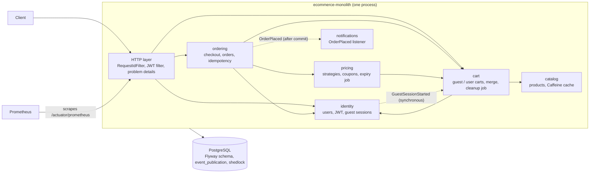

# E-Commerce Monolith

An e-commerce backend built as a **single deployable Spring Boot application**, focused on the part of an online shop where correctness is hardest: **pricing, promotions, coupons and the cart under concurrency**.

It is one half of a pair. The same domain is also implemented as a distributed system in **[ecommerce-microservice](https://github.com/SasiPiro/ecommerce-microservice)**, which focuses on the problems that only exist once a system is split into services. See [Why two repositories](#why-two-repositories-monolith-vs-microservices).

> **Status:** the pricing, cart and checkout flow works end to end and is covered by integration tests; a checkout records an order with a price snapshot and is idempotent; module boundaries are verified with Spring Modulith and modules react to each other through domain events; the application and its tests run on PostgreSQL with Flyway migrations; metrics are exported to Prometheus and catalog lookups are cached locally. It ships as one Docker image, runs with `docker compose up`, and every push runs the whole test suite in GitHub Actions.

---

## Contents

- [What it does](#what-it-does)
- [Design decisions worth reading](#design-decisions-worth-reading)
- [Why two repositories: monolith vs microservices](#why-two-repositories-monolith-vs-microservices)
- [Architecture](#architecture)
- [Project structure](#project-structure)
- [Tech stack](#tech-stack)
- [Running locally](#running-locally)
- [API overview](#api-overview)
- [Testing](#testing)
- [Configuration](#configuration)
- [Known limits](#known-limits)

---

## What it does

- **Guest and registered shoppers.** A guest gets a signed token and a cart immediately; after logging in, the guest cart is merged into the user cart (quantities added, never lost).
- **Pricing engine.** Automatic promotions as pluggable strategies (VIP, Black Friday, Christmas) combined with coupon codes, with business rules (seasonal promotions are not cumulative with coupons, total discount capped at 100%).
- **Coupons with usage limits.** Each coupon has a usage limit and an expiry date; the last use can never be sold twice, even under concurrent checkouts.
- **Checkout and orders.** A read-only quote (`GET /checkout/quote`) and a confirmation (`POST /checkout`) that prices the cart on the server, redeems the coupon, closes the cart and records an order with a price snapshot in one transaction. An `Idempotency-Key` header makes a retried checkout return the same order instead of buying twice.
- **Scheduled jobs.** Coupon expiry every minute and cleanup of abandoned guest carts every night, safe to run with several instances.
- **Order history and notifications.** Shoppers read their own orders only; a placed order publishes `OrderPlaced`, delivered to the notifications module after the purchase commits.
- **Ready to operate.** Health and Prometheus endpoints with business metrics, one Docker image, `docker compose up` with PostgreSQL, and a CI pipeline that runs every test on PostgreSQL.

---

## Design decisions worth reading

Each of these was a real bug in an earlier version of the code, reproduced with a test before being fixed.

| Problem | Decision | Where |
|---|---|---|
| The client sent prices in the checkout request | The cart is always loaded from the database; the checkout endpoint has no body | `PaymentService`, `PricingEngine` |
| A coupon could be oversold, or burned by a preview | Redemption is one conditional `UPDATE ... WHERE current_usage < usage_limit`; previews never redeem | `CouponRepository.tryRedeem` |
| Concurrent first requests created duplicate carts (HTTP 500) | Unique constraints plus a row lock on the user (`SELECT ... FOR UPDATE`) and a second check | `CartService.getCartEntity` |
| Reading a cart cost one query per product (N+1) | One `JOIN FETCH` query; Open-Session-in-View disabled | `CartOwnershipRepository` |
| Jobs loaded rows, chunked them and saved them from threads | One set-based SQL statement per job | `PromotionExpiryJob`, `CartCleanupJob` |
| Every instance ran every job | ShedLock: one execution per window across instances, timed by the database clock | `SchedulingConfig` |
| Entities and tables drifted apart unnoticed (once every cart query failed) | The schema is created only by Flyway migrations; Hibernate validates it at startup and refuses to start on a mismatch | `db/migration` |
| Tests ran on H2, which locks and constrains differently | Every test runs on PostgreSQL in a Testcontainers container | `TestcontainersConfiguration` |
| A JWT secret was committed with a default value | No default; startup fails without a strong secret | `JwtUtil` |
| A purchase left only the closed cart, linked to current prices | An order keeps product codes and unit prices as they were at checkout | `Order`, `OrderLine` |
| A client retrying after a timeout could buy twice | `Idempotency-Key` header; the unique constraint on the key is the real guard, and a request that loses the race answers with the winner's order | `OrderService.placeOrder` |
| Ten concurrent retries of one checkout all answered 500 after 30 seconds (seen only on PostgreSQL) | The idempotent orchestration runs outside any transaction scope, so a checkout holds one pooled connection instead of two | `OrderService.placeOrder` |
| Adding Spring Modulith started every scheduled job, even with scheduling disabled | `spring-modulith-moments`, whose auto-configuration declares `@EnableScheduling`, is excluded | `pom.xml` |
| A metric could count a checkout that rolled back | Business metrics are recorded only after the transaction commits | `AfterCommit` |
| Logs mixed formats and logged business errors as ERROR | One `[EVENT] key=value` format, levels by meaning, a request id on every line | `RequestIdFilter`, `GlobalExceptionHandler` |

The choices that differ from the microservices repository (one transaction instead of a saga, HMAC instead of RS256, a local cache instead of Redis, ...) are explained [below](#the-decisions-that-differ-and-what-they-cost).

---

## Why two repositories: monolith vs microservices

Both repositories implement an e-commerce backend on purpose. Seeing the same domain solved twice makes the trade-offs concrete: each repository concentrates on the problems its architecture is good at, instead of duplicating features.

**State of the other repository.** ecommerce-microservice is work in progress: the API gateway, Keycloak authentication, user-service and product-service with one database each exist; the order flow (saga, outbox, Kafka), Redis, circuit breakers, Testcontainers, Kubernetes and CI are designed but not built yet. The table marks them *planned*; this repository describes only what is in its code.

| Concern | ecommerce-monolith (this repo, implemented) | [ecommerce-microservice](https://github.com/SasiPiro/ecommerce-microservice) |
|---|---|---|
| Focus | Deep domain logic: pricing, promotions, coupons, cart, orders | The order flow across services, and operating a distributed system |
| Consistency | One ACID transaction: cart claim, coupon redemption, order and event publication commit or roll back together | Saga with compensations across order, stock and payment (*planned*) |
| Duplicate requests | `Idempotency-Key` header, unique constraint on the order key | Idempotent consumers, because the broker redelivers (*planned*) |
| Events between parts | `OrderPlaced` in process (Spring Modulith), stored in `event_publication` in the same transaction | Transactional outbox and Kafka (*planned*) |
| Boundaries | Packages, verified by `ModularityTests` | Processes and the network |
| Data | One PostgreSQL, one Flyway history, foreign keys across modules | One PostgreSQL per service, no cross-service joins or foreign keys |
| Authentication | The application issues and verifies its own JWT (HMAC) | Keycloak issues tokens (RS256); the gateway verifies them with the public keys and forwards the identity |
| Caching | Caffeine, in-process | Redis shared by the replicas (*planned*) |
| Failure handling | An exception, and the transaction rolls back | Timeouts, retries on reads, circuit breakers, fallbacks (*planned*) |
| Observability | Request id in every log line; one Prometheus endpoint with business metrics | Correlation id across services; Prometheus, Grafana, Loki (*planned*) |
| Tests | Every test on PostgreSQL (Testcontainers), concurrency races included | H2 today, Testcontainers *planned* |
| Delivery | One image, Compose with the application and its database, one CI workflow | One image per service, Kubernetes, one workflow per service (*planned*) |

**When a monolith is the right choice, as practiced here:** a single team, a domain whose rules must change together (a promotion touches cart, pricing and checkout at once), and a need for strong consistency. You get one transaction, one deployment, one place to debug, and refactoring across modules is a compiler-checked change instead of a coordinated API migration. **The price:** everything scales and deploys together, and without discipline the code turns into a "big ball of mud". The [module boundaries](#architecture), verified by tests with Spring Modulith, address the second point.

### The decisions that differ, and what they cost

**1. Checkout: one transaction instead of a saga.**
*Here:* `PaymentService.placeOrder` claims the cart (conditional `UPDATE`), redeems the coupon (conditional `UPDATE`), inserts the order with its lines and the event publication, and gives the owner a fresh cart, all in one PostgreSQL transaction.
*There:* stock, payment and order live in different databases, so each step commits on its own and a later failure needs a compensating action (release the stock, refund the payment).
*Impact:* here any failure rolls everything back, coupon use included, and no intermediate state is ever visible; there is no compensation code to write or test. The price is that everything involved must live in one database and scale with it. A saga accepts states such as "order pending" that users can see, and every step needs its compensation and its tests.

**2. Duplicate requests: an idempotency key instead of idempotent consumers.**
*Here:* the client sends one `Idempotency-Key` per checkout attempt; the unique constraint on `orders.idempotency_key` is the real guard, and a request that loses a race answers with the winner's order. The lookup runs outside the checkout transaction, so it sees the winner's commit and holds no second connection.
*There:* a broker delivers at least once, so every consumer must recognize a message it already processed (a processed-messages table or naturally idempotent operations).
*Impact:* one constraint on one table gives "at most one order per key" here. Across a database and a broker that guarantee cannot come from a single transaction: deduplication becomes code in every consumer.

**3. Events: an in-process registry instead of an outbox and Kafka.**
*Here:* `OrderPlaced` is a Java record published inside the checkout transaction and stored in `event_publication` with it; the `notifications` listener runs after the commit, asynchronously, in its own transaction. A failed delivery stays incomplete and can be resubmitted.
*There:* an outbox table is written in the service's transaction and a relay publishes it to Kafka for other services.
*Impact:* both give "if the order commits, the event is not lost", but here there is no broker to run, no network hop, and an event is a type: renaming a field is a refactoring the compiler checks. There an event is a contract between separately deployed services and must be versioned, and consumer lag and partition ordering become operational concerns. The price here: listeners run in the same process and scale with it.

**4. Boundaries: verified packages instead of processes.**
*Here:* each module exposes only its root package; `ModularityTests` fails the build on access to another module's `internal` package or on a dependency cycle. Its first run found four real couplings, now removed: the exception handler depended on every module (each exception now carries its own HTTP mapping through `BusinessException`), identity created the guest cart directly (it now publishes `GuestSessionStarted`), cart used identity's `JwtUtil` (now `AuthFacade.verifiedGuestId`), and checkout used cart's repository (now `CartService.claimForCheckout`).
*There:* the boundary is the network: crossing it by accident is impossible, and every crossing is an API with latency, failures and versioning.
*Impact:* here a boundary violation is a failing test and moving code between modules is an IDE refactoring. A synchronous reaction inside one transaction remains possible where it matters: the guest cart is created by a synchronous listener before the guest token is returned, which across services would be a remote call that can fail.

**5. Data: one database instead of one per service.**
*Here:* one schema, one Flyway history validated by Hibernate at startup; `orders.user_id` is a foreign key to `user_app`, and any report is a join.
*There:* each service owns its database; references to another service's data are plain ids checked through APIs or events, and reports need replicated data.
*Impact:* referential integrity and joins are free here. One decision is the same in both on purpose: order lines copy product code and unit price at checkout and have no foreign key to `product`, because an order must not change when the catalog does. That is also exactly what a separate order service would need.

**6. Authentication: HMAC instead of RS256.**
*Here:* the same process signs and verifies tokens with one HMAC key; startup fails if the key is missing, shorter than 32 bytes or publicly known. Several instances share the key through `JWT_SECRET`.
*There:* only Keycloak holds the private key; the gateway verifies tokens with the public keys (JWKS) and forwards the identity in `X-User-*` headers.
*Impact:* a symmetric key is simpler and fast, and it is safe while the key never leaves the application. With many verifiers a shared secret would let any of them forge tokens; public-key verification avoids that and allows key rotation without redeploying services. The price is a new trust problem: services must accept identity headers only from the gateway.

**7. Caching: a local cache instead of Redis.**
*Here:* product lookups by code are cached in-process with Caffeine (`ProductRepository.findByCode`, 5 minutes, at most 1000 entries, unknown codes not cached, evicted on save).
*There:* a Redis cache shared by the replicas of product-service.
*Impact:* a local cache needs no network hop and no extra infrastructure. The limit is explicit: with several instances each has its own cache, so a product update reaches the others only when their entry expires. Acceptable for catalog data; never used for what must be exact, since prices at checkout are read with the cart from the database.

**8. Failure handling and observability.**
*Here:* a failure is an exception in one process: the transaction rolls back and `GlobalExceptionHandler` turns it into a problem detail. One request id in the logs and one Prometheus endpoint describe the whole system; business metrics (`shop_coupon_redeemed_total`, `shop_checkout_amount`) are recorded only after commit.
*There:* every remote call can be slow or fail, so it needs timeouts, retries (on idempotent reads only) and circuit breakers, so that a slow product-service does not exhaust the gateway; a correlation id must be propagated through headers, and logs and metrics are collected centrally.
*Impact:* debugging here is one stack trace and one log stream. There, the tooling is not optional: without it a failure is not even visible.

**9. Tests and delivery.**
*Here:* every test runs on PostgreSQL in Testcontainers (one container per Spring context), so the concurrency tests prove what the real database does with row locks and unique constraints; running on PostgreSQL is what exposed the idempotency connection problem in decision 2. One Dockerfile, one Compose file with two containers, one CI workflow that runs the whole suite on every push.
*There:* each service is built, tested and deployed on its own, and the contracts between services need their own tests.
*Impact:* one green build here means the whole system works together. The price is that everything is released together.

---

## Architecture



Solid arrows are method calls into another module's public API; dotted arrows are domain events.

The code is organized by business module, one package each: `catalog`, `identity`, `cart`, `pricing`, `ordering`, `notifications`, plus `shared` (clock, error handling, request id, scheduling). What other modules may use sits in the module's root package; everything else is in its `internal` sub-package.

The boundaries are verified by [Spring Modulith](https://spring.io/projects/spring-modulith) in `ModularityTests`: a module that reaches into another module's `internal` package, or a dependency cycle between modules, fails the build. Allowed dependencies today: `ordering` → `cart`, `pricing`, `identity`; `pricing` → `cart`, `identity`; `cart` → `catalog`, `identity`; everything → `shared`. Where a dependency would point the other way, the module publishes an event instead (identity announces a new guest, cart creates its cart). The same test writes the module diagrams to `target/spring-modulith-docs`.

**Domain events.** A placed order publishes `OrderPlaced`; the `notifications` module reacts with an `@ApplicationModuleListener`, asynchronously, after the checkout commits and in its own transaction, so a slow or failing notification never slows down or rolls back a purchase, and `ordering` does not know who listens. Every publication is stored in the `event_publication` table in the checkout transaction and marked complete when the listener succeeds; a failed (or interrupted) delivery stays incomplete and can be resubmitted. This is the in-process counterpart of the transactional outbox used in the microservices repository, without a broker.

**Checkout in one transaction:**

1. Load the caller's cart with items and products (one query).
2. Atomically move the cart from `ACTIVE` to `CHECKOUT` (a double-submitted checkout gets 409).
3. Check the coupon combination rule, then redeem the coupon with a conditional update.
4. Price the cart on the server: base total, applied strategies, coupon, 100% cap.
5. Record the order with a snapshot of the lines and prices; its idempotency key is unique.
6. Mark the cart `PURCHASED` and give the owner a fresh cart.
7. Publish `OrderPlaced`, stored in the event publication registry; listeners run after the commit.

If any step fails, the whole transaction rolls back, coupon use included. In the microservices repository the equivalent flow needs a saga.

---

## Project structure

```
src/main/java/com/ecommerce/monolith/
├── catalog/          Product, ProductRepository (cached lookups by code)
├── identity/         User, Role, AuthFacade, GuestSessionStarted
│   └── internal/     AuthController, AuthService, JwtUtil, SecurityConfig
├── cart/             Cart, CartItem, CartService
│   └── internal/     CartController, ownership, repositories, CartCleanupJob
├── pricing/          PricingEngine, CouponService, Coupon, @TrackPromotion
│   └── internal/     promotion strategies, PromotionConfig, PromotionExpiryJob, pricing audit
├── ordering/         OrderPlaced (the only type other modules may use)
│   └── internal/     checkout and order services, controllers, Order, OrderLine
├── notifications/    OrderNotifications
└── shared/           TimeService, BusinessException, AfterCommit, AppConstants
    └── internal/     GlobalExceptionHandler, RequestIdFilter, scheduling, caching
src/main/resources/db/migration/   schema, applied in every environment
src/main/resources/db/seed/        sample data, dev profile and Compose only
```

---

## Tech stack

| Layer | Technology |
|---|---|
| Language | Java 21 (virtual threads enabled) |
| Framework | Spring Boot 4 |
| Security | Spring Security, JWT (jjwt, HMAC) |
| Persistence | Spring Data JPA, Hibernate, PostgreSQL |
| Scheduling | `@Scheduled` with ShedLock (JDBC provider) |
| Modularity | Spring Modulith (verified module boundaries, domain events with a JPA publication registry) |
| Observability | Spring Boot Actuator, Micrometer, Prometheus |
| Caching | Spring Cache with Caffeine (local, per instance) |
| Cross-cutting | Spring AOP (pricing audit), RFC 7807 problem details |
| Tests | JUnit 5, MockMvc, AssertJ, Mockito, Hibernate statistics, Testcontainers (PostgreSQL) |
| Delivery | Multi-stage Dockerfile, Docker Compose, GitHub Actions |

---

## Running locally

**Prerequisites:** JDK 21 and Docker.

```bash
./mvnw spring-boot:test-run -Dspring-boot.run.profiles=dev
```

`spring-boot:test-run` starts `TestEcommerceMonolithApplication`, which runs the application against a PostgreSQL container started by Testcontainers: there is no database to install. To use a PostgreSQL you run yourself, `./mvnw spring-boot:run -Dspring-boot.run.profiles=dev` connects to `localhost:5432`, database, user and password `ecommerce`.

The schema is created by the Flyway migrations in `db/migration` at startup. The `dev` profile provides a local JWT secret, the local database settings, the sample data (`db/seed`, applied only in `dev`), and CORS for `localhost:3000` and `localhost:5173`. **Without a profile the application refuses to start** unless `JWT_SECRET` and the database settings are provided: this is intentional.

**With Docker Compose** (the application image and PostgreSQL, nothing else to install):

```bash
cp .env.example .env    # set JWT_SECRET (e.g. openssl rand -base64 48) and POSTGRES_PASSWORD
docker compose up --build
```

The application waits for the database health check, applies the migrations and the sample data, and listens on `localhost:8080`. Compose refuses to start while a secret in `.env` is empty. `docker compose down -v` removes the containers and the database volume.

Seed users (local only): `JAY` / `jay-password` (VIP, admin) and `admin` / `admin-password` (VIP, admin). Products `P001`-`P004`, coupons `SAVE10` (one use left) and `FLASH50`.

**A complete flow with curl:**

```bash
# 1. Log in
TOKEN=$(curl -s -X POST localhost:8080/api/v1/auth/login \
  -H 'Content-Type: application/json' \
  -d '{"username":"admin","password":"admin-password"}' | jq -r .token)

# 2. Add products
curl -s -X POST localhost:8080/api/v1/cart/items -H "Authorization: Bearer $TOKEN" \
  -H 'Content-Type: application/json' -d '{"productCode":"P002","quantity":2}'

# 3. Preview the total with a coupon (does not consume it)
curl -s "localhost:8080/api/v1/checkout/quote?couponCode=FLASH50" -H "Authorization: Bearer $TOKEN"

# 4. Confirm: one key per checkout attempt, sent again unchanged if the client retries
curl -s -X POST "localhost:8080/api/v1/checkout?couponCode=FLASH50" -H "Authorization: Bearer $TOKEN" \
  -H "Idempotency-Key: $(uuidgen)"

# 5. Order history
curl -s localhost:8080/api/v1/orders -H "Authorization: Bearer $TOKEN"
```

---

## API overview

| Method | Path | Auth | Description |
|---|---|---|---|
| POST | `/api/v1/auth/register` | public | Create a user with the `CUSTOMER` role |
| POST | `/api/v1/auth/login` | public | Returns a JWT |
| POST | `/api/v1/auth/guest` | public | Returns a guest JWT and creates the guest cart |
| GET | `/api/v1/cart` | user or guest | The caller's cart |
| POST | `/api/v1/cart/items` + body `{"productCode","quantity"}` | user or guest | Add a product (1-99 units per line) |
| PATCH | `/api/v1/cart/items/{productCode}` + body `{"quantity"}` | user or guest | Set the quantity of a line (1-99) |
| DELETE | `/api/v1/cart/items/{productCode}` | user or guest | Remove a product |
| POST | `/api/v1/cart/merge` + header `X-Guest-Token` | user | Merge the guest cart into the user cart |
| GET | `/api/v1/checkout/quote?couponCode=` | user or guest | Price preview, never redeems the coupon |
| POST | `/api/v1/checkout?couponCode=` + header `Idempotency-Key` | user or guest | Confirm the purchase: 201 with the order and its `Location`; 200 with the same order when the key is replayed |
| GET | `/api/v1/orders` | user or guest | The caller's orders, newest first |
| GET | `/api/v1/orders/{id}` | user or guest | One of the caller's orders (404 for anyone else's) |
| GET | `/actuator/health` | public | Liveness and readiness for load balancers and orchestrators |
| GET | `/actuator/prometheus` | public | Metrics in Prometheus format (restrict at network level in production) |

**Metrics.** Besides the standard JVM, connection pool and HTTP metrics (with histogram buckets, so p95/p99 latency is computed by Prometheus across instances), two business metrics are recorded only when the checkout transaction commits: `shop_coupon_redeemed_total{code}` (redemptions per coupon code) and `shop_checkout_amount_count/_sum/_max{outcome}` (orders and amounts paid). Tags are low-cardinality on purpose: never a user id or an order id.

Errors are [RFC 7807](https://www.rfc-editor.org/rfc/rfc7807) problem details: 400 validation, 401 authentication, 403 authorization, 404 not found (also for another shopper's order), 409 conflicts (duplicate username, concurrent checkout, non-cumulative coupon, idempotency key used by another shopper), 410 expired coupon. Every response carries an `X-Request-Id` header, also printed on every log line of that request.

---

## Testing

```bash
./mvnw test
```

**Continuous integration:** `.github/workflows/ci.yml` runs `./mvnw -B verify` on every push and pull request (GitHub runners have Docker, so Testcontainers works there too) and builds the image on `master`. One workflow for one artifact, where the microservices repository needs one per service.

Docker must be running: every Spring test context gets its own PostgreSQL container, so concurrency tests prove what the real database does (row locks, conditional updates, unique constraints), not what an in-memory substitute does.

| Test class | What it proves |
|---|---|
| `CheckoutFlowTests` | Login, guest cart, server-side pricing (a tampered body is ignored), coupons, merge |
| `CheckoutFlowTests.lastCouponUse...` | 20 virtual threads race for the last coupon use: exactly one wins |
| `OrderTests` | A checkout records an order whose prices do not change with the catalog; the same key twice, or ten times concurrently, gives one order and one coupon use; orders are visible only to their owner |
| `ModularityTests` | No module uses another module's internals, no dependency cycles; writes the module diagrams |
| `OrderEventsTests` | A placed order publishes `OrderPlaced` and the listener runs after the commit; a failed delivery stays incomplete in the registry until resubmitted |
| `CartConcurrencyTests` | 16 concurrent first requests of a new user: all 200, one cart |
| `CartQueryCountTests` | Reading a cart costs the same number of SQL statements with 1 or 4 products |
| `SchedulerJobsTests` | Both jobs touch only what they must; a second trigger inside the lock window is skipped |
| `JwtSecurityTests` | Weak or previously public secrets are rejected; a forged token gets 401 |
| `CorsTests`, `ProductionDefaultsTests` | Dev conveniences are off without the `dev` profile |
| `CatalogCacheTests` | The second lookup of a product code runs no SQL; saving a product evicts it; unknown codes are not cached |
| `MetricsTests` | `/actuator/prometheus` exposes HTTP histograms and the business metrics; a redemption that rolls back is not counted |
| `LoggingTests`, `RequestIdTests` | Log format, levels, no duplicates, no secrets, request id propagation |

---

## Configuration

| Variable | Default | Purpose |
|---|---|---|
| `JWT_SECRET` | none (required) | HMAC signing key, at least 32 bytes |
| `JWT_EXPIRATION` | `86400000` | Token lifetime in milliseconds |
| `CORS_ALLOWED_ORIGINS` | empty | Comma-separated browser origins allowed to call the API |
| `SPRING_DATASOURCE_URL` | none (required) | PostgreSQL JDBC URL, e.g. `jdbc:postgresql://db:5432/ecommerce` |
| `SPRING_DATASOURCE_USERNAME`, `SPRING_DATASOURCE_PASSWORD` | none (required) | Database credentials |
| `SPRING_PROFILES_ACTIVE` | none | `dev` for local development only |
| `SPRING_FLYWAY_LOCATIONS` | `classpath:db/migration` | Add `classpath:db/seed` for the sample data (the `dev` profile and Compose do) |
| `LOGGING_STRUCTURED_FORMAT_CONSOLE` | unset | `ecs` or `logstash` for JSON log lines |

Promotion percentages and the seasonal windows (days of the year, repeated every year) are in `application.yaml` under `promotions`. The cache size and expiry are under `spring.cache`, the exposed actuator endpoints under `management`.

---

## Known limits

Deliberate trade-offs, or work not done yet:

- **`/actuator/prometheus` and `/actuator/health` are public**, for the scraper and the orchestrator. In production restrict them at network level (a separate management port or an ingress rule).
- **Failed notifications are not retried automatically.** A failed `OrderPlaced` delivery stays incomplete in `event_publication`; it is resubmitted through `IncompleteEventPublications`, which nothing schedules yet.
- **The product cache is per instance** and holds detached `Product` entities shared between threads. That is fine while nothing modifies a looked-up product (no code does); a cache of read-only DTOs would be safer once products become editable.
- **The Black Friday window moves every year** and must be updated in `promotions.black-friday`.
- **CI builds the image but does not publish it**: pushing to a registry needs credentials and a release policy.

---

## License

[MIT](LICENSE)
