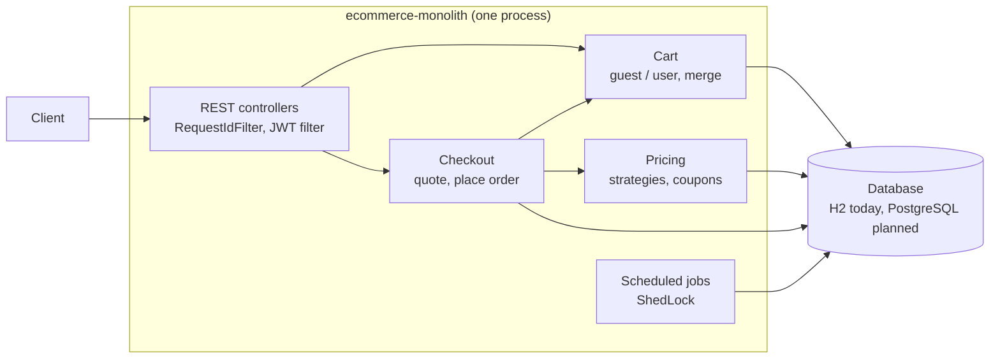

# E-Commerce Monolith

An e-commerce backend built as a **single deployable Spring Boot application**, focused on the part of an online shop where correctness is hardest: **pricing, promotions, coupons and the cart under concurrency**.

It is one half of a pair. The same domain is also implemented as a distributed system in **[ecommerce-microservice](https://github.com/SasiPiro/ecommerce-microservice)**, which focuses on the problems that only exist once a system is split into services. See [Why two repositories](#why-two-repositories-monolith-vs-microservices).

> **Status:** the pricing, cart and checkout flow works end to end and is covered by integration tests; a checkout records an order with a price snapshot and is idempotent. Next steps are explicit modules with Spring Modulith and PostgreSQL with Testcontainers (see [Planned next](#planned-next-and-why)).

---

## Contents

- [What it does](#what-it-does)
- [Design decisions worth reading](#design-decisions-worth-reading)
- [Why two repositories: monolith vs microservices](#why-two-repositories-monolith-vs-microservices)
- [Architecture](#architecture)
- [Tech stack](#tech-stack)
- [Running locally](#running-locally)
- [API overview](#api-overview)
- [Testing](#testing)
- [Configuration](#configuration)
- [Planned next, and why](#planned-next-and-why)

---

## What it does

- **Guest and registered shoppers.** A guest gets a signed token and a cart immediately; after logging in, the guest cart is merged into the user cart (quantities added, never lost).
- **Pricing engine.** Automatic promotions as pluggable strategies (VIP, Black Friday, Christmas) combined with coupon codes, with business rules (seasonal promotions are not cumulative with coupons, total discount capped at 100%).
- **Coupons with usage limits.** Each coupon has a usage limit and an expiry date; the last use can never be sold twice, even under concurrent checkouts.
- **Checkout and orders.** A read-only quote (`GET /checkout/quote`) and a confirmation (`POST /checkout`) that prices the cart on the server, redeems the coupon, closes the cart and records an order with a price snapshot in one transaction. An `Idempotency-Key` header makes a retried checkout return the same order instead of buying twice.
- **Scheduled jobs.** Coupon expiry every minute and cleanup of abandoned guest carts every night, safe to run with several instances.

---

## Design decisions worth reading

Each of these was a real bug in an earlier version of the code, reproduced with a test before being fixed.

| Problem | Decision | Where |
|---|---|---|
| The client sent prices in the checkout request | The cart is always loaded from the database; the checkout endpoint has no body | `PaymentService`, `PricingEngine` |
| A coupon could be oversold, or burned by a preview | Redemption is one conditional `UPDATE ... WHERE current_usage < usage_limit`; previews never redeem | `CouponRepository.tryRedeem` |
| Concurrent first requests created duplicate carts (HTTP 500) | Unique constraints plus a row lock on the user (`SELECT ... FOR UPDATE`) and a second check | `CartService.getCartEntity` |
| Reading a cart cost one query per product (N+1) | One `JOIN FETCH` query; Open-Session-in-View disabled | `CartOwnershipRepository` |
| Jobs loaded rows, chunked them and saved them from threads | One set-based SQL statement per job | `PromotionExpiryJob`, `CartCleanupJob` |
| Every instance ran every job | ShedLock: one execution per window across instances, timed by the database clock | `SchedulingConfig` |
| A JWT secret was committed with a default value | No default; startup fails without a strong secret | `JwtUtil` |
| A purchase left only the closed cart, linked to current prices | An order keeps product codes and unit prices as they were at checkout | `Order`, `OrderLine` |
| A client retrying after a timeout could buy twice | `Idempotency-Key` header; the unique constraint on the key is the real guard, and a request that loses the race answers with the winner's order | `OrderService.placeOrder` |
| Logs mixed formats and logged business errors as ERROR | One `[EVENT] key=value` format, levels by meaning, a request id on every line | `RequestIdFilter`, `GlobalExceptionHandler` |

**Why HMAC (symmetric) JWTs here:** the same application signs and verifies tokens, so the secret never leaves it. In the microservices repository many services verify tokens, so there Keycloak signs with RS256 and services only hold the public key.

---

## Why two repositories: monolith vs microservices

Both repositories implement an e-commerce backend on purpose. Seeing the same domain solved twice makes the trade-offs concrete: each repository concentrates on the problems its architecture is good at, instead of duplicating features.

| Concern | ecommerce-monolith (this repo) | [ecommerce-microservice](https://github.com/SasiPiro/ecommerce-microservice) |
|---|---|---|
| Focus | Deep domain logic: pricing, promotions, coupons, cart | The order flow across services, and operating a distributed system |
| Consistency | One ACID transaction across cart, coupon and purchase | Eventual consistency: saga with compensations, transactional outbox |
| Concurrency | Database constraints, atomic conditional updates, row locks | Idempotent consumers, distributed locks where needed |
| Communication | In-process method calls and domain events | HTTP through the gateway, asynchronous events on Kafka |
| Authentication | The app issues and verifies its own JWT (HMAC) | Keycloak issues tokens (RS256); services only verify with a public key |
| Failure handling | A failure is an exception in one process | Timeouts, retries on reads, circuit breakers, fallbacks |
| Observability | Request id in every log line of one process | Correlation id across services, metrics per service, central logs |
| Deployment | One artifact, one database | One image and one database per service, Kubernetes |

**When a monolith is the right choice, as practiced here:** a single team, a domain whose rules must change together (a promotion touches cart, pricing and checkout at once), and a need for strong consistency. You get one transaction, one deployment, one place to debug, and refactoring across modules is a compiler-checked change instead of a coordinated API migration. **The price:** everything scales and deploys together, and without discipline the code turns into a "big ball of mud". The [planned module boundaries](#planned-next-and-why), verified by tests with Spring Modulith, address the second point.

---

## Architecture



The code is organized by business module, one package each: `catalog`, `identity`, `cart`, `pricing`, `ordering`, plus `shared` (clock, error handling, request id, scheduling). What other modules may use sits in the module's root package; everything else is in its `internal` sub-package.

The boundaries are verified by [Spring Modulith](https://spring.io/projects/spring-modulith) in `ModularityTests`: a module that reaches into another module's `internal` package, or a dependency cycle between modules, fails the build. Allowed dependencies today: `ordering` → `cart`, `pricing`, `identity`; `pricing` → `cart`, `identity`; `cart` → `catalog`, `identity`; everything → `shared`. Where a dependency would point the other way, the module publishes an event instead (identity announces a new guest, cart creates its cart). The test also writes the module diagrams to `target/spring-modulith-docs`.

**Checkout in one transaction:**

1. Load the caller's cart with items and products (one query).
2. Atomically move the cart from `ACTIVE` to `CHECKOUT` (a double-submitted checkout gets 409).
3. Check the coupon combination rule, then redeem the coupon with a conditional update.
4. Price the cart on the server: base total, applied strategies, coupon, 100% cap.
5. Record the order with a snapshot of the lines and prices; its idempotency key is unique.
6. Mark the cart `PURCHASED` and give the owner a fresh cart.

If any step fails, the whole transaction rolls back, coupon use included. In the microservices repository the equivalent flow needs a saga.

---

## Tech stack

| Layer | Technology |
|---|---|
| Language | Java 21 (virtual threads enabled) |
| Framework | Spring Boot 4 |
| Security | Spring Security, JWT (jjwt, HMAC) |
| Persistence | Spring Data JPA, Hibernate, H2 (PostgreSQL planned) |
| Scheduling | `@Scheduled` with ShedLock (JDBC provider) |
| Modularity | Spring Modulith (verified module boundaries) |
| Cross-cutting | Spring AOP (pricing audit), RFC 7807 problem details |
| Tests | JUnit 5, MockMvc, AssertJ, Mockito, Hibernate statistics |

---

## Running locally

**Prerequisites:** JDK 21.

```bash
./mvnw spring-boot:run -Dspring-boot.run.profiles=dev
```

The `dev` profile provides a local JWT secret, the H2 console (`http://localhost:8080/h2-console`, JDBC URL `jdbc:h2:mem:testdb`) and CORS for `localhost:3000` and `localhost:5173`. **Without a profile the application refuses to start** unless `JWT_SECRET` is set: this is intentional.

Seed users (local only): `JAY` / `jay-password` (VIP, admin) and `admin` / `admin-password` (VIP, admin). Products `P001`-`P004`, coupons `SAVE10` (one use left) and `FLASH50`.

**A complete flow with curl:**

```bash
# 1. Log in
TOKEN=$(curl -s -X POST localhost:8080/api/v1/auth/login \
  -H 'Content-Type: application/json' \
  -d '{"username":"admin","password":"admin-password"}' | jq -r .token)

# 2. Add products
curl -s -X POST localhost:8080/api/v1/cart/items -H "Authorization: Bearer $TOKEN" \
  -H 'Content-Type: application/json' -d '{"productCode":"P002","quantity":2}'

# 3. Preview the total with a coupon (does not consume it)
curl -s "localhost:8080/api/v1/checkout/quote?couponCode=FLASH50" -H "Authorization: Bearer $TOKEN"

# 4. Confirm: one key per checkout attempt, sent again unchanged if the client retries
curl -s -X POST "localhost:8080/api/v1/checkout?couponCode=FLASH50" -H "Authorization: Bearer $TOKEN" \
  -H "Idempotency-Key: $(uuidgen)"

# 5. Order history
curl -s localhost:8080/api/v1/orders -H "Authorization: Bearer $TOKEN"
```

---

## API overview

| Method | Path | Auth | Description |
|---|---|---|---|
| POST | `/api/v1/auth/register` | public | Create a user with the `CUSTOMER` role |
| POST | `/api/v1/auth/login` | public | Returns a JWT |
| POST | `/api/v1/auth/guest` | public | Returns a guest JWT and creates the guest cart |
| GET | `/api/v1/cart` | user or guest | The caller's cart |
| POST | `/api/v1/cart/items` + body `{"productCode","quantity"}` | user or guest | Add a product (1-99 units per line) |
| PATCH | `/api/v1/cart/items/{productCode}` + body `{"quantity"}` | user or guest | Set the quantity of a line (1-99) |
| DELETE | `/api/v1/cart/items/{productCode}` | user or guest | Remove a product |
| POST | `/api/v1/cart/merge` + header `X-Guest-Token` | user | Merge the guest cart into the user cart |
| GET | `/api/v1/checkout/quote?couponCode=` | user or guest | Price preview, never redeems the coupon |
| POST | `/api/v1/checkout?couponCode=` + header `Idempotency-Key` | user or guest | Confirm the purchase: 201 with the order and its `Location`; 200 with the same order when the key is replayed |
| GET | `/api/v1/orders` | user or guest | The caller's orders, newest first |
| GET | `/api/v1/orders/{id}` | user or guest | One of the caller's orders (404 for anyone else's) |

Errors are [RFC 7807](https://www.rfc-editor.org/rfc/rfc7807) problem details: 400 validation, 401 authentication, 403 authorization, 404 not found (also for another shopper's order), 409 conflicts (duplicate username, concurrent checkout, non-cumulative coupon, idempotency key used by another shopper), 410 expired coupon. Every response carries an `X-Request-Id` header, also printed on every log line of that request.

---

## Testing

```bash
./mvnw test
```

| Test class | What it proves |
|---|---|
| `CheckoutFlowTests` | Login, guest cart, server-side pricing (a tampered body is ignored), coupons, merge |
| `CheckoutFlowTests.lastCouponUse...` | 20 virtual threads race for the last coupon use: exactly one wins |
| `OrderTests` | A checkout records an order whose prices do not change with the catalog; the same key twice, or ten times concurrently, gives one order and one coupon use; orders are visible only to their owner |
| `ModularityTests` | No module uses another module's internals, no dependency cycles; writes the module diagrams |
| `CartConcurrencyTests` | 16 concurrent first requests of a new user: all 200, one cart |
| `CartQueryCountTests` | Reading a cart costs the same number of SQL statements with 1 or 4 products |
| `SchedulerJobsTests` | Both jobs touch only what they must; a second trigger inside the lock window is skipped |
| `JwtSecurityTests` | Weak or previously public secrets are rejected; a forged token gets 401 |
| `CorsTests`, `ProductionDefaultsTests` | Dev conveniences are off without the `dev` profile |
| `LoggingTests`, `RequestIdTests` | Log format, levels, no duplicates, no secrets, request id propagation |

---

## Configuration

| Variable | Default | Purpose |
|---|---|---|
| `JWT_SECRET` | none (required) | HMAC signing key, at least 32 bytes |
| `JWT_EXPIRATION` | `86400000` | Token lifetime in milliseconds |
| `CORS_ALLOWED_ORIGINS` | empty | Comma-separated browser origins allowed to call the API |
| `SPRING_PROFILES_ACTIVE` | none | `dev` for local development only |
| `LOGGING_STRUCTURED_FORMAT_CONSOLE` | unset | `ecs` or `logstash` for JSON log lines |

Promotion percentages and the seasonal windows (days of the year, repeated every year) are in `application.yaml` under `promotions`.

---

## Planned next, and why

Each step strengthens what a monolith is good at, instead of imitating a distributed system.

| Step | Why |
|---|---|
| **Modules with Spring Modulith** | The main risk of a monolith is erosion, not performance: module boundaries become a test that fails, and modules talk through in-process domain events with a publication registry (the in-process counterpart of the outbox used in the microservices repository) |
| **PostgreSQL, Flyway, Testcontainers** | Correctness here relies on database behavior (conditional updates, row locks, constraints): the concurrency tests prove something only on the real database |
| **Metrics and a local catalog cache** | Business metrics (coupons redeemed, checkout totals) next to technical ones; a local cache is enough in one process, Redis is used where several replicas must share it |
| **Docker and CI** | One image, one pipeline: the operational simplicity that is the point of a monolith |

---

## License

[MIT](LICENSE)
